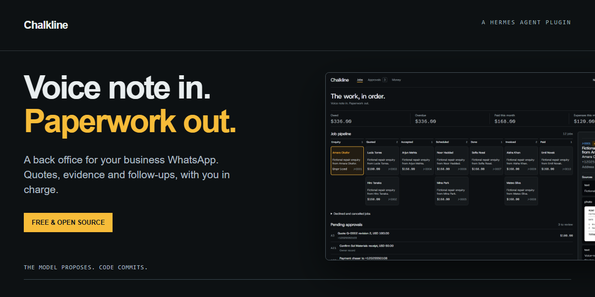
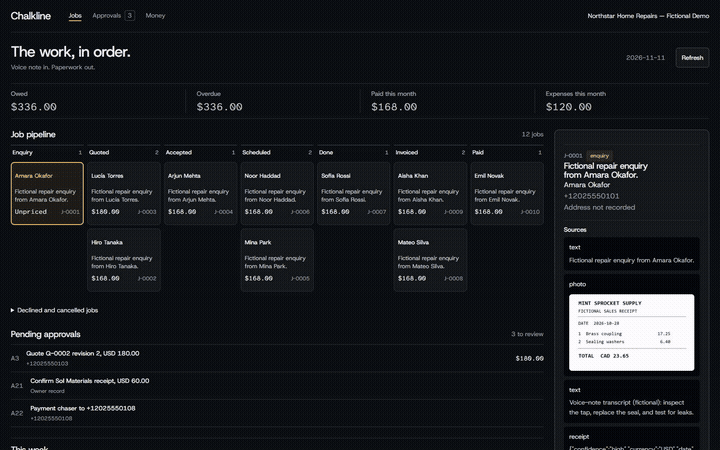

# Chalkline



**Voice note in. Paperwork out.**

No plugin subscription · Profile-local records · Owner-reviewed customer sends

Chalkline is a Hermes back office for a solo tradesperson. Capture enquiries, prepare quote and invoice PDFs, keep receipt evidence, and review follow-ups from the same job ledger. Set your business currency, rates, locale and timezone.



Live WhatsApp verification completed on 11 November 2026. This preview uses fictional demonstration data.

Chalkline uses plugin capabilities to keep these boundaries in code:

- **Silent customer intake:** a pre-dispatch hook records customer evidence without starting an agent turn.
- **Code-enforced approvals:** owner identity and the exact approved payload are checked before customer sends.
- **Zero-token scheduler tick:** deterministic cron work checks due reminders and claims deliveries without a model call.

## A job in five steps

1. A customer messages your dedicated business number. Chalkline captures the enquiry and attachments, then queues an acknowledgement from a template you approved.
2. You describe the work to your owner agent. It proposes a quote with line items and a PDF.
3. Review the exact proposal and approve its code. Chalkline queues the approved customer delivery.
4. Record the customer's acceptance, appointments, completion, agreed extras and receipts. Payment reports also require confirmation.
5. Review invoice chasers, record payment, and export the books as a ZIP.

Live tests with three WhatsApp accounts verified customer text, photo and native voice capture, one acknowledgement, owner-only quote approval, customer PDF receipt, replay prevention and one appointment reminder. The reminder used two accelerated executions of the real scheduler job. See [the validation record](docs/LIVE-VALIDATION.md).

## Let Hermes set it up

You don't need to type any of the commands below yourself. Send this repository link to your Hermes agent and say:

> Install and set up Chalkline from https://github.com/levi-lvjp/chalkline for my business. Follow its README.

Hermes can run the installation and fill in your settings. It will ask for your business name, your personal phone number, your currency, your timezone and your hourly rate. Three steps stay with you:

1. Use your business phone to scan the WhatsApp QR code when Hermes shows it.
2. Read the two message templates, then approve each one with the code Hermes gives you.
3. Restart Hermes when it asks.

After that, everything happens in WhatsApp. The manual steps below are the same steps Hermes follows.

## Quickstart

Tested locally on Hermes **v0.22.2**, Windows. Chalkline uses the provider and model already configured in Hermes; it does not select a model or require a separate model login. Owner drafting uses Hermes tool calling. Receipt extraction needs a vision-capable configured provider; owner voice commands depend on Hermes speech transcription.

The package slug is `chalkline`; catalog publication is pending. Install from the source repository:

```sh
hermes plugins install https://github.com/levi-lvjp/chalkline --yes-deps --enable
hermes plugins list
```

For a local checkout, use its absolute file URL for installation and its directory for Doctor. The installation prepares `fpdf2>=2.8.4,<3` under Hermes' dependency constraints.

**Hermes Cloud:** the same agent package is intended for the selected Cloud profile, with its Desktop UI half enabled separately where needed. Cloud installation, the browser Webapp and Cloud WhatsApp pairing have not been verified for this entry. A Cloud host needs persistent storage and the messaging bridge prerequisites. Local offline tests establish the current compatibility floor.

### Connect WhatsApp

Use a **dedicated business number**, separate from your personal owner phone. Hermes uses the unofficial **Baileys WhatsApp Web bridge**. WhatsApp may restrict or ban the linked number. Use a test number first and keep an independent way to contact customers.

Run Hermes' `hermes whatsapp` setup, choose **bot mode**, and scan the QR from the business phone under WhatsApp → Linked devices. Configure a distinct bridge port and session directory when other Hermes gateways run on the machine. Self-chat mode drops customer traffic and cannot provide this intake workflow.

Use a dedicated standalone profile with the plugin enabled and office-only tools. Customers must reach the bridge and adapter for the front-desk hook to capture them. Run the business profile in a Hermes home of its own, or mark it `gateway.standalone: true`, or start it with `hermes gateway run --force`. Read [the Desktop/backend notes](desktop/README.md) for the isolated profile setup. Pairing and three-account WhatsApp delivery were verified live on 11 November 2026.

### Set up the office

In the Hermes CLI, enter `/office setup` to see the setup schema. Then supply your settings as a JSON object:

```text
/office setup {"restrict_toolsets":true,"business_name":"Example Repairs","owner_phones":["+12025550101"],"currency":"USD","locale":"en-US","timezone":"UTC","hourly_rate":"75.00","material_billing_rule":"cost","tax_rate":"0","payment_terms_days":14,"templates":{"enquiry_ack":"Thanks for contacting {business_name}. We have received your enquiry.","appointment_reminder":"Reminder from {business_name}: your appointment is at {appointment_start}."}}
```

Replace the fictional phone with your personal owner's number. Review each returned template code, then type `/office approve <code>` in the CLI. Setup creates one recurring 15-minute no-agent tick. The gateway/scheduler must be running for unattended ticks to fire.

From a second consenting phone, send a fictional enquiry to the business number. Check `/office jobs`, `/office job J-0001` and `/office pending`. Verify capture and one acknowledgement before using real customer data.

## Features

- **Keep the evidence.** Customer text, photos and native voice paths attach to jobs. Phone-private WhatsApp identities are retained for owner review. Repeated receipt bytes dedupe.
- **Prepare the paperwork.** Quotes have revisions; invoices snapshot lines and include agreed extras. Money uses integer minor units with Decimal rounding. Receipt extraction produces an expense proposal.
- **Follow up with approval.** Quote follow-ups and invoice chasers are drafts for review. Chaser stages are day 7, 14 and 30 after the due date. Appointment reminders use approved templates at 24 hours and one hour.
- **See the office.** The plain Desktop page shows the pipeline, balances, approvals, appointments, evidence and job audit history. Export includes `income.csv`, `expenses.csv` and receipt files.

Useful CLI commands:

```text
/office pending
/office approve A17
/office reject A17
/office jobs
/office job J-0001
/office digest
/office export 2026-11-01 2026-11-30
```

The owner can also use literal `APPROVE A17` / `REJECT A17` in an idle WhatsApp DM, verified Telegram buttons via `/office_pending`, or the authenticated Desktop approval page. Hermes' busy-session lane can delay WhatsApp approval intake; review the pending code before retrying.

## Safety and approvals

The model proposes. Code validates state transitions, recomputes totals and commits the ledger. Money commitments and ordinary customer messages use single-use, payload-bound approvals that expire after 24 hours. Editing a payload invalidates its earlier approval.

Three template kinds can receive standing approval: enquiry acknowledgement, appointment reminder and review request. Editing a template needs fresh approval. Acknowledgements are capped at one per customer per 12-hour window, and stored customer attachments at 30 per sender per 24 hours; an unresolved phone receives no automatic customer reply.

Customers are captured before a normal owner agent turn. They cannot approve codes. Owner tools verify transport identity, and the business profile restricts its toolsets. Customer evidence is untrusted input, including when the owner agent reads it.

Payment, hold and void actions cancel pending chasers as applicable. Delivery outcomes are sent, failed or unknown. Timeouts, partial delivery and interrupted sends can become unknown; an unknown row is never automatically resent. The owner receives a delivery-result notice. External exactly-once delivery cannot be guaranteed.

## Privacy and data

The active Hermes profile stores SQLite records at `plugin-data/chalkline/data.db`. Copies of evidence, PDFs and ZIP exports live beneath `plugin-data/chalkline/`. On Cloud this is the Cloud host's storage. Hermes also maintains its own sessions, caches and messaging bridge credentials.

The customer intake hook makes no model call. Customer text, transcripts and metadata can reach the configured model when the owner invokes the job query, and excerpts appear in owner notices. Job queries return file references, rather than automatically uploading customer photo/audio bytes. The receipt tool explicitly sends a valid cached receipt image to `ctx.llm.complete_structured`; a customer-supplied image can therefore reach that provider if selected for receipt processing. Owner messages and media also follow Hermes' configured model, vision and speech-provider policies.

Chalkline adds no telemetry endpoint. Hermes and configured providers have their own policies. Outbound text/PDFs use the public `hermes send` CLI and WhatsApp bridge. Telegram buttons use Hermes' Telegram handler integration. Setup writes a recurring Python script into the profile's `scripts/` directory.

Export before deleting data. To remove the ledger and evidence, stop the profile gateway and remove only that profile's `plugin-data/chalkline/` directory. Removing the plugin alone does not erase that directory. Remove its `chalkline-tick` cron job and generated script if retiring the office. Hermes sessions/caches and provider retention require separate cleanup.

## Limits

- Live WhatsApp intake, quote PDF delivery and reminders were verified with consenting test accounts and fictional job details; Cloud operation remains unverified.
- Customer voice notes are stored without automatic transcription. Owner voice transcription depends on Hermes configuration.
- One currency per business. An optional owner-entered flat tax rate is arithmetic, with no jurisdiction-specific tax rules.
- No payment processing, payment links, email, bank reconciliation or tax filing. An accountant should review the export.
- The authenticated Desktop page and backend were verified locally with fictional data at 390px. Native Desktop activation and Cloud/Webapp operation remain unverified.
- Receipt extraction can be wrong. Low-confidence proposals require correction before confirmation.

## FAQ

**Do I need another number?** Use a dedicated business/test number for the unofficial bridge, and your personal phone as the owner identity.

**Can a customer approve their own quote?** The customer hook consumes their message as evidence. Approval routes verify owner identity and the exact stored payload.

**What if WhatsApp restricts the number?** The local ledger and exports remain available. Customer messaging needs a working transport; keep a separate contact method.

**Does it work offline?** Ledger arithmetic, dedupe and deterministic scheduling logic run locally. WhatsApp needs connectivity; model-assisted drafting/extraction needs a reachable configured provider. A local model can serve that part.

**What does it cost?** There is no plugin subscription code. Model, hosting and messaging costs depend on your configuration.

**What if a send is duplicated or uncertain?** Stage keys and atomic claims prevent automatic re-sends of the same outbox row. Unknown delivery requires owner investigation.

**Which countries?** Configure currency, locale and an IANA timezone. Local accounting requirements remain your responsibility.

**Can I change the business name or a template?** Use `/office setup` with updated JSON. Template changes require new approval. Currency changes are restricted after monetary records exist.

## Development

Catalog submission is pending; local screenshots, a dashboard preview and live verification notes are included. Code is distributed under the [MIT licence](LICENSE); the bundled Noto Sans font retains its [OFL licence](fonts/OFL.txt). Use fictional fixtures for testing. Run the offline tests with the Hermes source/dependencies available; messaging HTTP boundaries are mocked.

Chalkline uses a durable ledger, approval hashes, source dedupe and deterministic scheduled work so those checks remain in code across agent turns. Contributions should preserve those boundaries and include a regression test for changed behavior.

Setup requires a dedicated named business-number profile and explicit "restrict_toolsets": true. It backs up config.yaml to config.yaml.bak before restricting WhatsApp, Telegram, CLI and cron to Chalkline tools. Invalid settings leave config unchanged. Restart after setup. Once enabled in a gateway, the hook intercepts non-owner WhatsApp traffic, including before office setup; configure the owner identity before connecting customer traffic. Automatic acknowledgements require an approved template.

The live test used a separate Hermes home containing only the business profile and started its gateway with `gateway run --force`. Hermes v0.22.2 retires `gateway.multiplex_profiles: false`; do not rely on that setting for isolation. Keep the test home and bridge session separate from your ordinary Hermes profiles.
